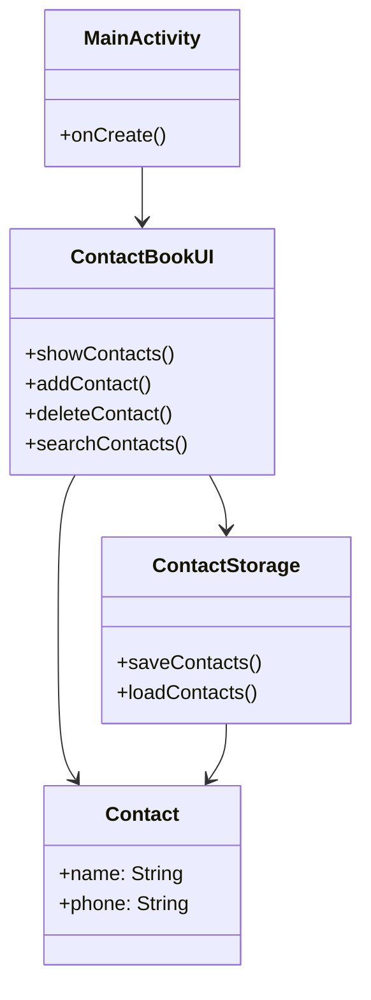
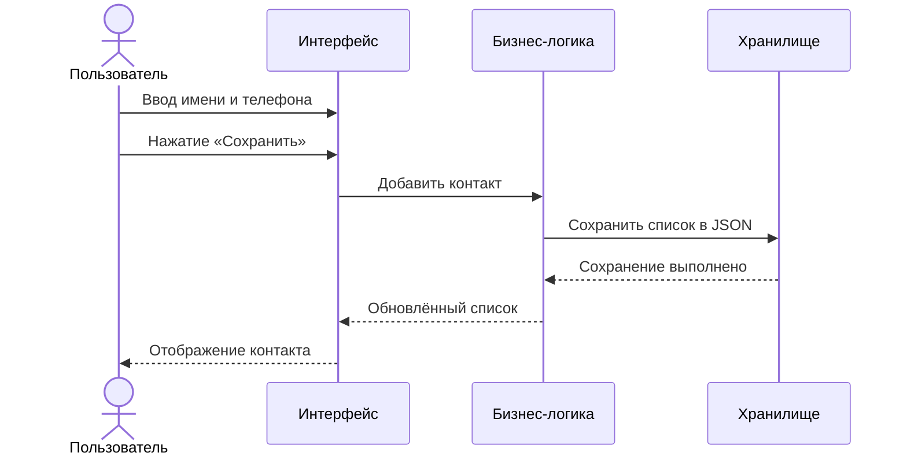
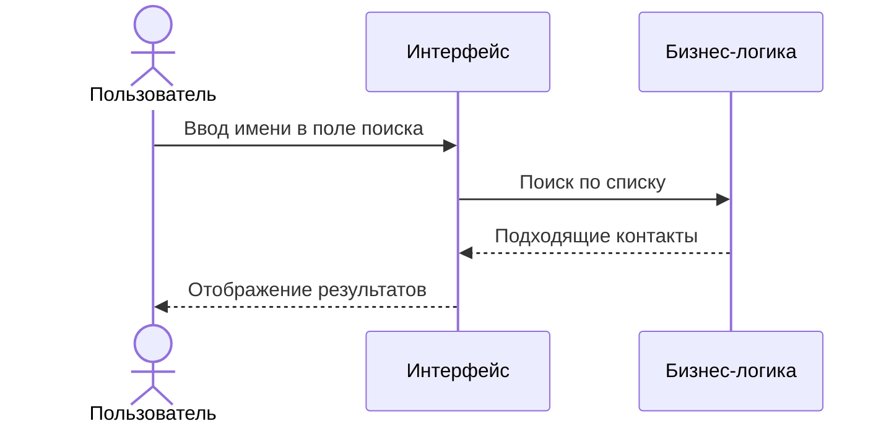
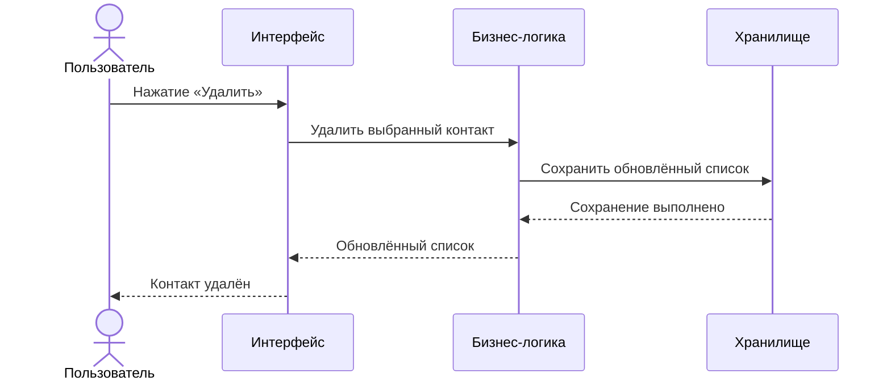

# Архитектура приложения «Записная книжка контактов»

## 1. Назначение приложения

Приложение «Записная книжка контактов» предназначено для хранения и поиска контактной информации на мобильном устройстве Android.

Проект разработан на языке Kotlin с использованием Jetpack Compose.

## 2. Архитектура приложения

В приложении выделяются три логических слоя:

1. **Пользовательский интерфейс (UI)** — отображает список контактов, поле поиска, форму добавления и кнопку удаления.
2. **Бизнес-логика** — обрабатывает добавление, удаление и поиск контактов.
3. **Слой данных** — обеспечивает сохранение и загрузку контактов с помощью SharedPreferences и JSON.

В текущей реализации эти части логически разделены, но могут находиться в одном файле MainActivity.kt.

## 3. Структура приложения

```text
ContactBook
|
+-- MainActivity.kt
    |
    +-- Пользовательский интерфейс
    |   +-- Список контактов
    |   +-- Поиск контактов
    |   +-- Добавление контакта
    |   +-- Удаление контакта
    |
    +-- Бизнес-логика
    |   +-- Добавление записи
    |   +-- Фильтрация списка
    |   +-- Удаление записи
    |
    +-- Хранение данных
        +-- SharedPreferences
        +-- JSON
```

## 4. Диаграмма классов и компонентов



Диаграмма показывает логические компоненты приложения. ContactBookUI и ContactStorage обозначают функциональные части, а не обязательно отдельные классы исходного кода.

## 5. Диаграммы последовательности

### Сценарий 1. Добавление контакта



### Сценарий 2. Поиск контакта



### Сценарий 3. Удаление контакта



## 6. Основные операции

- Добавление нового контакта с именем и номером телефона.
- Отображение сохранённых контактов.
- Поиск контактов по имени.
- Удаление выбранного контакта.
- Сохранение данных между запусками приложения.

Редактирование существующего контакта рассматривается как дополнительная функция, которую необходимо реализовать отдельно.

## 7. Используемые технологии

- Kotlin — язык программирования.
- Jetpack Compose — создание интерфейса.
- SharedPreferences — локальное хранение данных.
- JSON — формат представления сохранённых контактов.
- Android Studio — среда разработки.

## 8. Вывод

Разработана и проверена основная функциональность мобильного приложения «Записная книжка контактов». Архитектура включает пользовательский интерфейс, бизнес-логику и хранение данных. Приложение позволяет добавлять, искать и удалять контакты, а также сохранять их между запусками.
