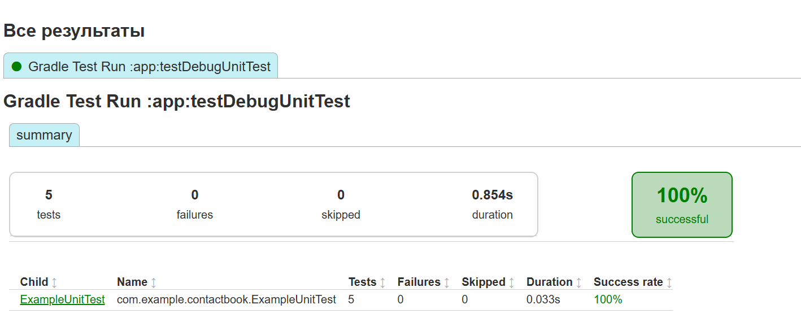

# День 7. Автоматическое тестирование

## 1. Общая информация

- Проект: «Записная книжка контактов».
- Вариант: 14.
- Язык программирования: Kotlin.
- Среда разработки: Android Studio.
- Инструмент тестирования: JUnit.

## 2. Цель тестирования

Проверка корректности работы основных функций приложения с помощью модульных тестов.

## 3. Перечень автоматических тестов

| № | Проверяемая функция | Результат |
|---|---|---|
| 1 | Проверка имени контакта | Успешно |
| 2 | Проверка номера телефона | Успешно |
| 3 | Поиск контакта по имени | Успешно |
| 4 | Поиск контакта по номеру телефона | Успешно |
| 5 | Генерация идентификатора контакта | Успешно |

## 4. Результаты тестирования

- Всего тестов: 5.
- Успешно пройдено: 5.
- Ошибок: 0.
- Пропущено: 0.
- Процент успешного прохождения: 100%.
- Время выполнения: 0,854 секунды.
- Статус сборки: BUILD SUCCESSFUL.

## 5. Подтверждение результатов

## 6. Возникшие трудности

При первоначальном запуске тестов возникла ошибка загрузки класса GradleWorkerMain.

Для решения проблемы был установлен альтернативный путь к кэшу Gradle: C:\GradleCache.

После изменения пути автоматические тесты успешно выполнены.

## 7. Заключение

Все пять автоматических тестов успешно пройдены.

По итогам ручного и автоматического тестирования выполнено 17 тестов: 12 ручных и 5 автоматических.

В рамках проведённых проверок ошибок в тестируемых функциях приложения не выявлено.
